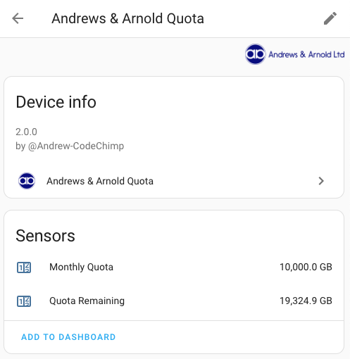

<!-- ha-marketplace:exclude-start -->
# Home Assistant Andrews & Arnold Quota Integration

[![GitHub Release][releases-shield]][releases]
[![GitHub Activity][commits-shield]][commits]
[![Downloads][download-latest-shield]]()
[![Installs][marketplace-installs-shield]][hacs-install]
[![marketplace][marketplacebadge]][marketplace]
[![Community Forum][forum-shield]][forum]
[![License][license-shield]](LICENSE)

<!-- ha-marketplace:exclude-end -->
⚠️RETIRED - Andrews & Arnold are discontinuing their API in 2026.

Integration to get broadband quota from [Andrews & Arnold](https://www.aa.net.uk).

**This integration will set up the following platforms.**

| Platform | Description                                |
|----------|--------------------------------------------|
| `sensor` | Show info from Andrews & Arnold Quota API. |

## Sensors

| Sensor                                  | Description     |
|:----------------------------------------|-----------------|
| `sensor.andrews_arnold_XXXXX_monthly_quota`   | Monthly Quota, XXXXX is your line id to support multiple lines  |
| `sensor.andrews_arnold_XXXXX_quota_remaining` | Quota Remaining, XXXXX is your line id to support multiple lines |

*Please ⭐ this repo if you find it useful*  
*If you want to show your support please*

<!-- ha-marketplace:exclude-start -->
## Marketplace/HACS Installation

Or search for Andrews & Arnold Quota within Marketplace/HACS if My Home Assistant does not work for you.

Restart Home Assistant if using HACS

In the HA UI go to "Configuration" -> "Integrations" click "+" and search for "Andrews & Arnold Quota"  
<!-- ha-marketplace:exclude-end -->

## Configuration

Enter your control account details to connect to the Andrews & Arnold API.

Data is refreshed every 30 minutes.

## Disclaimer

This integration is in no way approved, endorsed or supported by Andrews & Arnold Ltd.

***

[andrews_arnold_quota]: https://github.com/andrew-codechimp/HA-Andrews-Arnold-Quota
[commits-shield]: https://img.shields.io/github/commit-activity/y/andrew-codechimp/HA-Andrews-Arnold-Quota.svg?style=for-the-badge
[commits]: https://github.com/andrew-codechimp/HA-Andrews-Arnold-Quota/commits/main
[forum-shield]: https://img.shields.io/badge/community-forum-brightgreen.svg?style=for-the-badge
[forum]: https://community.home-assistant.io/t/custom-component-andrews-arnold-uk-broadband-quota/595491
[license-shield]: https://img.shields.io/github/license/andrew-codechimp/HA-Andrews-Arnold-Quota.svg?style=for-the-badge
[releases-shield]: https://img.shields.io/github/release/andrew-codechimp/HA-Andrews-Arnold-Quota.svg?style=for-the-badge
[releases]: https://github.com/andrew-codechimp/HA-Andrews-Arnold-Quota/releases
[download-latest-shield]: https://img.shields.io/github/downloads/andrew-codechimp/HA-Andrews-Arnold-Quota/latest/total?style=for-the-badge
[marketplace-installs-shield]: https://img.shields.io/badge/dynamic/json?url=https%3A%2F%2Fanalytics.home-assistant.io%2Fcustom_integrations.json&query=%24.andrews_arnold_quota.total&style=for-the-badge&label=Marketplace%20installs
[marketplace-install]: https://my.home-assistant.io/redirect/marketplace_repository/?owner=andrew-codechimp&repository=andrews_arnold_quota&category=integration
[hacs-install]: https://my.home-assistant.io/redirect/hacs_repository/?owner=andrew-codechimp&repository=HA-Andrews-Arnold-Quota&category=Integration
[marketplace]: https://home-assistant.io/integrations/marketplace
[marketplacebadge]: https://img.shields.io/badge/Marketplace-Default-41BDF5.svg?style=for-the-badge
